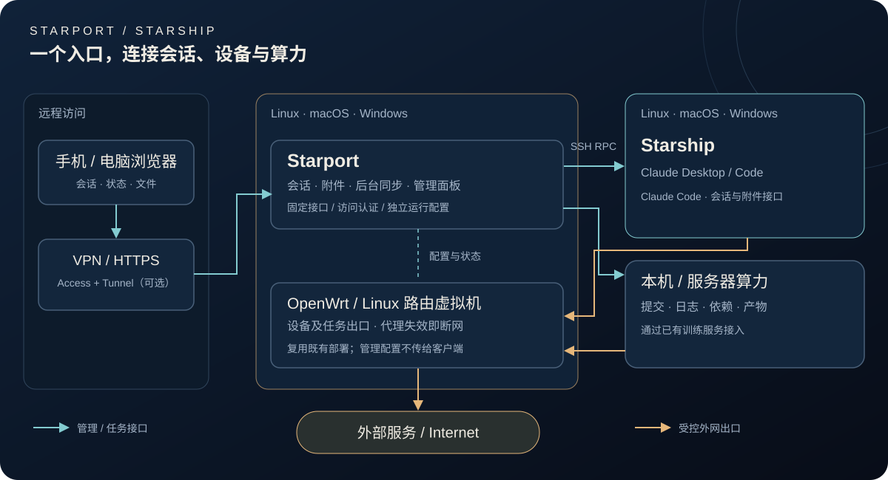

# Starport


[安装](docs/INSTALL.md) · [会话控制](docs/CONSOLE.md) · [网络与出口](docs/NETWORK.md) · [服务管理](docs/SERVICES.md)

**Starport 是地面站，Starship 是星舰。** 在手机或电脑上接续 Claude 会话，查看任务、文件与设备状态。

| 组件 | 安装位置 | 职责 |
| --- | --- | --- |
| **Starport · 服务端** | Linux 中继电脑 | 网页控制台、消息缓存、服务面板、软路由与算力适配 |
| **Starship · 客户端** | 受控设备，当前支持 macOS | Claude Desktop／Code 会话、实时状态、文件与成品读取 |

## 网络拓扑



浏览器通过 VPN 或受保护的 HTTPS 入口访问 Starport。Starport 通过固定 SSH 接口连接 Starship；设备与训练任务的外网出口由既有软路由控制，代理失效时断网。路由与算力是可选适配，独立于会话控制台安装。

## 快速开始

在 Linux 安装 **Starport**：

```sh
./install.sh server --check
./install.sh server --ssh-host starship
./bin/starport urls
./bin/starport key
```

在 Mac 安装 **Starship**：

```sh
./install.sh client --check
./install.sh client
./bin/starship status
```

两端需要 Python 3.10+；服务端还需要 Node.js 22.12+、npm、OpenSSH 和 systemd。Mac 先完成 Claude Code 登录并开启远程登录，服务端按 [SSH 示例](examples/ssh.example.conf) 配对。默认仅开放本机回环；VPN、HTTPS 与旧环境接入见[安装指南](docs/INSTALL.md)。

## 工作台

| 能力 | 内容 |
| --- | --- |
| 会话 | Remote Control 自动发现、后台会话、历史接续、模型与 effort 切换 |
| 实时记录 | 持续后台同步、增量刷新、处理状态与耗时、工具输入和输出 |
| 阅读与下载 | Markdown、图片、视频、PDF、Artifacts HTML 快照 |
| 手机访问 | 紧凑会话布局、折叠信息、压缩响应、静态资源缓存 |
| 管理面板 | 服务注册、软路由检查、订阅导入、主备节点选择 |
| 算力适配 | 复用已有任务、GPU／CPU／内存、传输、存储与清理监控 |

发送消息时自动简体转繁体，无发送预览。停止、新建和批准操作保留确认；会话与文件接口始终需要认证。

## 目录

```text
server/              Starport 会话后端与网页源码、Linux 安装器
client/              Starship 设备服务源码、macOS 安装器
isolation_toolkit/   管理面板、服务发现和软路由适配
web/                 管理面板界面
bin/                 starport / starship 命令
examples/            配置示例
docs/                安装、网络与使用指南
```

旧安装的命令、服务和配置仍可通过适配器使用；新安装统一使用 Starport／Starship 名称。

## 开发

```sh
python3 -m pip install -r server/requirements.txt
python3 -m unittest discover -s tests
(cd server/console && python3 -m unittest discover -s tests)
(cd server/console/web && npm ci --ignore-scripts && npm test && npm run build)
node --test tests/markdown.test.cjs
python3 audit_repository.py
```
