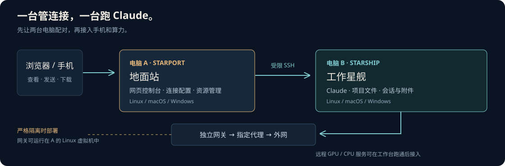

# Starport

**把另一台电脑上的 Claude，变成随时可访问的工作台。**
用浏览器或手机接续会话、上传图片、查看执行过程，下载报告和视频。



**Starport 是地面站，Starship 是星舰。** A 管连接，B 保存 Claude、项目和会话。
两端均支持 Linux、macOS、Windows；需要严格网络隔离时，增加独立 Linux／OpenWrt 网关。

## 从哪里开始

| 你的情况 | 入口 |
| --- | --- |
| 有两台空电脑 | [交互教程](https://hku-ouge.github.io/Starport/quickstart/) · [文字版步骤](docs/QUICKSTART.md) |
| 想让 Agent 安装 | [7 个引导 Skills](docs/SKILLS.md) · [AGENTS.md](AGENTS.md) |
| 客户端是 Mac | [新 Mac 清单](docs/MAC.md) |
| 已安装，遇到问题 | [排障、更新与卸载](docs/MAINTENANCE.md) |

教程可直接打开 `docs/quickstart/index.html`，安装后从管理面板进入。

## 最短安装路径

先在两台电脑下载仓库。A 需要 Python 3.10+、Node.js 22.12+、npm 和 OpenSSH；
B 需要 Python 3.10+、已登录的 Claude Code，以及 SSH 服务。

```sh
# B：安装客户端
python3 tools/preflight.py client
python3 setup.py client

# A：按配对指南连接 B，再安装服务端
python3 tools/pair.py verify
python3 setup.py server --ssh-host starship
python3 starport.py urls
```

Windows 使用 `py -3`；B 是 Windows 时，A 的安装命令增加 `--client-platform windows`。
想手动运行而不注册登录启动，增加 `--no-register`，再用 `tools/run_services.py` 启动对应角色。
详细过程见[两台电脑教程](docs/QUICKSTART.md)和 [SSH 配对](docs/PAIRING.md)。

## 能做什么

| 能力 | 使用方式 |
| --- | --- |
| 接续 Claude | 原生 Remote Control，或独立后台会话 |
| 看清执行过程 | 持续同步、增量消息、状态与耗时、工具输入和输出 |
| 图片与文件 | 上传附件、断点续传、图片／视频／PDF 预览、Artifacts 快照 |
| 手机控制 | 紧凑布局；通过 [VPN 或 Access + Tunnel](docs/REMOTE.md)访问 |
| 管理网络 | 导入订阅、选择主备节点、预览和应用受控出口计划 |
| 连接算力 | 对接已有隔离训练服务，查看资源、任务、日志和结果 |

会话发送时自动简体转繁体。访问码、账号登录和网络隔离是三个不同环节。
Starport 不会仅凭安装控制台就创建虚拟机、配置防火墙或建立云端训练环境。

## 使用指南

[日常使用](docs/GUIDE.md) · [会话与附件](docs/CONSOLE.md) · [网络与订阅](docs/NETWORK.md) ·
[算力与服务](docs/SERVICES.md) · [权限边界](docs/SECURITY.md)

## 开发

`server/` 是网页服务，`client/` 是设备服务，`isolation_toolkit/` 是管理适配层，
`compute_runtime/` 是 Linux 训练接管组件，`skills/` 与 `docs/` 提供操作指引。

```sh
python3 -m pip install -r server/requirements.txt
python3 -m unittest discover -s tests
(cd server/console && python3 -m unittest discover -s tests)
(cd server/console/web && npm ci --ignore-scripts && npm test && npm run build)
node --test tests/*.test.cjs
python3 audit_repository.py
```
