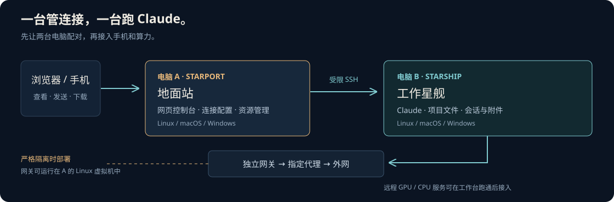

# 网络与订阅



**管理连接和上网出口分开。** A 通过受限 SSH 管理 B；严格隔离时，B 的外网只能经过独立网关和指定代理。

## 先选一种网络方案

| 场景 | 做法 |
| --- | --- |
| 已有可信局域网，只需要会话工作台 | 在现有私有路径配对；这不等于网络隔离 |
| 要求代理失效后断网 | 先建立独立 Linux／OpenWrt 网关，再接入 B |
| A 是 Linux | 可使用 KVM／QEMU 和专用网口／网桥 |
| A 是 macOS | 可使用 UTM／QEMU，配合专用有线口或 USB 网卡 |
| A 是 Windows | 可使用支持的 Hyper-V／QEMU 配置和独立虚拟交换机 |

Starport 安装器不会自动创建虚拟机或接管网卡。新部署先核对系统版本、网卡、网段和现有连接，
由部署 Agent 或管理员按下面的边界配置。参考：[UTM 网络](https://docs.getutm.app/settings-qemu/devices/network/network/)、
[Hyper-V 虚拟交换机](https://learn.microsoft.com/en-us/windows-server/virtualization/hyper-v/get-started/create-a-virtual-switch-for-hyper-v-virtual-machines)。

## 新网关需要做什么

| 步骤 | 要求 |
| --- | --- |
| 规划 | 明确 WAN、B 的 LAN、独立管理路径；检查网段冲突并保留管理员恢复入口 |
| 接线／虚拟交换机 | B 的专用 LAN 不接入主机 Internet Sharing；A 不在该 LAN 提供任意服务 |
| 独立守卫 | 默认阻断；仅允许管理接口、DNS 和批准的加密代理端点 |
| 代理与 DNS | 无 DIRECT 回退；节点失效时关闭出口；未支持的 UDP／IPv6 路径不放行 |
| B 的接口 | 使用网关 DHCP；检查 Wi-Fi、第二网卡和其他旁路 |
| 启动顺序 | 守卫 → 网桥和 WAN → 网关／代理／DNS → B 的有线连接 |

网关可在 A 的虚拟机运行，不必增加第三台物理电脑。不同宿主的网口接管方式不同，
不要直接照搬另一台电脑的接口名或防火墙文件。

## 将已有网关接入 Starport

Linux 网关需要先有独立守卫、代理、端点路由和受保护配置，然后安装固定执行器：

```sh
python3 router/install.py --check
sudo python3 router/install.py --config ../private/gateway-profile.json
```

执行器只管理已有配置，不替代网关首次部署。配置字段及示例见
[本机网关示例](../examples/router-profile.example.json)与[远端网关示例](../examples/router-remote.example.json)。
给网关使用专用 SSH 身份和固定执行命令，再在 A 安装时接入：

```sh
python3 setup.py server --router-profile ../private/router-remote.json
```

## 导入订阅与切换节点

1. 面板 → **订阅与节点**，导入 HTTPS 订阅或粘贴节点列表。
2. 按主用、第一备用、第二备用的顺序选择三个不同的受支持端点。
3. 生成计划，先检查，再应用。

```sh
python3 starport.py apply-exit PLAN_ID --check
python3 starport.py apply-exit PLAN_ID
```

支持 Clash／Mihomo YAML 和常见 SS、VMess、VLESS、Trojan URI。仅导入节点字段，
不采用订阅的路由规则、DNS、脚本或监听设置；UDP 型协议不会被自动放行。
订阅和节点凭据保存在操作端，页面不回显密码。

切换时先关闭出口、核对旧配置和节点白名单，再加载新配置。失败时恢复或保持断网。
计划有效期有限；涉及防火墙的操作通过管理员入口执行，不把管理员密码输入网页。

## 上线前验收

| 测试 | 应有结果 |
| --- | --- |
| B 的 DNS 与 HTTPS | 经选定出口成功 |
| 停止代理／全部节点失效 | B 无外网，不能直连回退 |
| 关闭路由虚拟机 | B 无外网 |
| 检查其他网卡、UDP、IPv6 | 没有绕过守卫的通路 |
| 恢复代理 | DNS／HTTPS 恢复 |
| 实际重启并登录 | 按批准的顺序恢复，不能先开放 B |

中断测试安排在不会影响已有工作的窗口。面板只读检查和节点名称不能代替这些测试。
上联网关自动更新取决于实际部署的监控服务，通用适配器不会自动安装宿主网关更新器。
