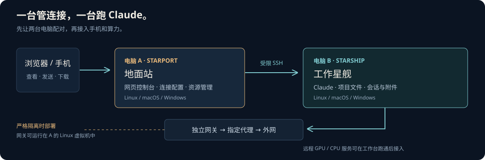

# 两台电脑，搭好一个工作台



**A 管连接，B 跑 Claude。** 手机或浏览器访问 A；项目、登录和会话留在 B。
第一次建议用 Linux 做 A、Mac 做 B，也可以分别选择 Windows、macOS 或 Linux。

打开[交互教程](quickstart/index.html)，选择两端系统、保存进度、复制对应命令。
想交给 Agent：在仓库中让它阅读 `AGENTS.md` 和 `skills/starport-onboard/SKILL.md`。

## 1. 准备两台电脑

| | A：Starport | B：Starship |
| --- | --- | --- |
| 软件 | Python 3.10+、Node.js 22.12+、npm、OpenSSH | Python 3.10+、Claude Code、OpenSSH 服务 |
| 保存什么 | 管理配置、专用 SSH 私钥、访问码 | Claude 登录、项目文件、会话 |
| 从哪里访问 | A 本机浏览器；以后可接手机 | A 通过受限 SSH 调用 |

两边下载本仓库。已有 Git 时执行：

```sh
git clone https://github.com/HKU-OUGE/Starport.git
cd Starport
```

没有 Git 可在 GitHub 选择 **Code → Download ZIP**，解压后在该目录打开终端。
Windows 后面的 `python3` 均换为 `py -3`。

## 2. 先确定网络

两端要能通过预定私有路径连接。只想使用会话工作台，可以在已有可信局域网中配对。
如果要求 B 只能走指定代理，先按[网络图和验收表](NETWORK.md)建立网关，再在 B 登录 Claude。
控制台安装器不会自动创建路由虚拟机或修改防火墙。

| 检查 | 合格状态 |
| --- | --- |
| A 到 B | 只开放需要的管理连接 |
| B 的外网出口 | 按选择的网络方案访问 |
| 严格隔离方案 | 代理全断时 B 断网；没有 Wi-Fi、IPv6 或共享网络旁路 |

## 3. 在 B 安装客户端

先按 [Claude 官方说明](https://code.claude.com/docs/en/setup)安装 Claude Code，打开它完成本机登录。
新 Mac 的远程登录、开发工具和权限见 [Mac 清单](MAC.md)。

```sh
python3 tools/preflight.py client
python3 setup.py client --check
python3 setup.py client
python3 starship.py status
```

安装时决定是否随用户登录启动。需要手动启动时，安装命令加 `--no-register`，然后运行：

```sh
python3 tools/run_services.py client
```

`status` 中 `ok` 表示服务可用，`authenticated` 表示账号已登录；两项分开看。

## 4. 配对 SSH

按[配对指南](PAIRING.md)完成：A 生成专用密钥 → B 接收公钥 → 核对 B 的主机指纹 → A 保存连接配置。

```sh
# 在 A 检查配对。B 是 Windows 时增加 --client-platform windows。
python3 tools/pair.py verify
```

配对密钥只允许 Starship 的固定接口。`ssh starship whoami` 应被拒绝，这是预期结果。

## 5. 在 A 安装服务端

```sh
python3 tools/preflight.py server
python3 setup.py server --check
python3 setup.py server --ssh-host starship
python3 starport.py urls
python3 starport.py key
```

B 为 Windows 时，在安装命令后增加 `--client-platform windows`。
不注册登录启动时加 `--no-register`，随后执行 `python3 tools/run_services.py server`。

默认打开 `http://127.0.0.1:18881/` 使用会话，`http://127.0.0.1:18882/` 管理服务。
访问码只在 A 本机查看并输入网页；无需发给 Agent。

## 6. 做一次完整验收

| 操作 | 应看到什么 |
| --- | --- |
| 打开会话页 | 设备可连接，能列出项目／会话 |
| 新建后台会话 | 选择 B 上的项目，可以发送并收到回复 |
| 接续 Desktop | 原会话已开启 Remote Control，消息出现在同一会话 |
| 上传一张图片／小文件 | Claude 收到附件，网页能读取或下载返回文件 |
| 锁屏 B | 已建立的后台服务继续可访问 |
| 重启后登录 B | 已选择自启的服务恢复；这项需要实际测试 |

新后台会话不会自动合并到 Desktop 的历史。先验证一条路径，再扩展另一条。

## 7. 按需扩展

| 需要 | 下一步 |
| --- | --- |
| 手机外网访问 | [VPN 或 Cloudflare Access + Tunnel](REMOTE.md) |
| 选择订阅与代理节点 | [受控网络出口](NETWORK.md) |
| 已有 GPU／CPU 训练服务 | [算力接入](SERVICES.md) |
| 让 Agent 维护 | [Skills 列表](SKILLS.md) |
| 更新、排障或卸载 | [维护指南](MAINTENANCE.md) |
